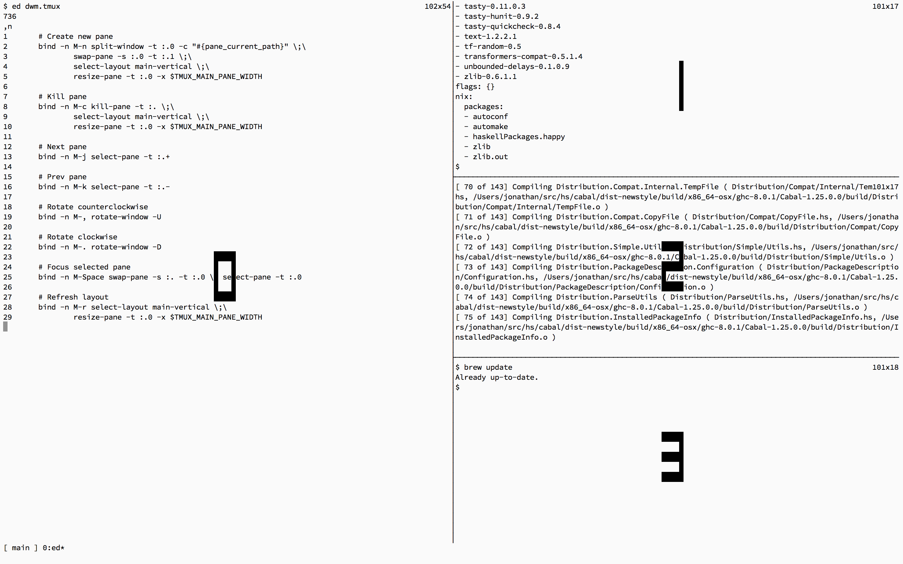

# dwm.tmux

[dwm](https://dwm.suckless.org/)-inspired pane management for tmux. Keep one main pane on the left and a stack on the right, promote panes, rotate their contents, and resize the main area.



Requires **tmux 3.2 or later** and a POSIX shell. No Go compiler or platform-specific binaries are needed.

## Install with TPM

Add dwm.tmux to your [Tmux Plugin Manager](https://github.com/tmux-plugins/tpm) configuration, before TPM initialization:

```tmux
set -g @plugin 'tmux-plugins/tpm'
set -g @plugin 'alxlu/dwm.tmux'

# Keep TPM initialization at the end of your configuration.
run '~/.tmux/plugins/tpm/tpm'
```

Reload your configuration, then press `prefix` + `I` to install. TPM loads the plugin from its own directory, so you do not need to add it to `PATH`.

## Manual installation

```sh
git clone https://github.com/alxlu/dwm.tmux.git
cd dwm.tmux
make install DATADIR="$HOME/.local/share/tmux/plugins/dwm.tmux" INSTALL_CLI=no
```

This keeps the plugin in one self-contained directory, alongside other tmux plugins. It needs no executable on `PATH`. Add this line to `~/.tmux.conf` (or your existing tmux configuration):

```tmux
run-shell '~/.local/share/tmux/plugins/dwm.tmux/dwm.tmux'
```

Then reload it in a running tmux session:

```sh
tmux source-file ~/.tmux.conf
```

Use any plugin directory by changing `DATADIR` and the `run-shell` path. Paths containing spaces are supported; quote the directory when invoking make and the executable path inside `run-shell`.

For example, install with `make install DATADIR="$HOME/My Tools/dwm.tmux" INSTALL_CLI=no` and load it with:

```tmux
run-shell '"$HOME/My Tools/dwm.tmux/dwm.tmux"'
```

To update a manual installation, run `git pull`, repeat the same install command, and reload your tmux configuration. To remove it, run `make uninstall DATADIR="$HOME/.local/share/tmux/plugins/dwm.tmux" INSTALL_CLI=no` and remove the `run-shell` line from your configuration.

If you also want a shell command, omit `INSTALL_CLI=no` to create `$HOME/.local/bin/dwm.tmux` as a symlink to the plugin's command dispatcher. Add `$HOME/.local/bin` to `PATH` and use the same setting when uninstalling. `INSTALL_CLI` defaults to `yes`; `INSTALL_CLI=no` leaves the CLI directory and any existing command untouched.

Plain `make install` retains the conventional layout: `$HOME/.local/share/dwm.tmux` plus the CLI link. Change the prefix with `PREFIX=/your/prefix`; the loader then lives at `/your/prefix/share/dwm.tmux/dwm.tmux`. Package maintainers can stage an installation with `make install PREFIX=/usr DESTDIR=/path/to/staging`.

## Commands and bindings

The default bindings use `Meta` (usually Alt). Both pane creation commands use the current pane's working directory. The table lists shell subcommands; their tmux aliases use the `dwm-` prefix, such as `dwm-newpane` and `dwm-promote`.

| Command | Default key | Action |
| --- | --- | --- |
| `newpane` | `Meta-n` | Create a pane in the stack. |
| `newpanecurdir` | `Meta-w` | Create a pane and promote it to the main area. |
| `killpane` | `Meta-c` | Close the current pane and retile; protect the last pane by default. |
| `nextpane` | `Meta-j` | Select the next pane. |
| `prevpane` | `Meta-k` | Select the previous pane. |
| `rotateccw` | `Meta-<` | Rotate pane contents counterclockwise. |
| `rotatecw` | `Meta->` | Rotate pane contents clockwise. |
| `layouttile` | `Meta-t` | Restore the main-and-stack layout. |
| `promote` (`zoom`) | `Meta-Enter` | Move the current pane into the main area. |
| `toggle-zoom` (`float`) | `Meta-Space` | Toggle tmux's full-window pane zoom. |
| `decmfact` | `Meta-h` | Shrink the main area. |
| `incmfact` | `Meta-l` | Enlarge the main area. |

`Meta-<` and `Meta->` usually mean Alt + Shift + comma/period. `zoom` and `float` remain compatibility names; `float` uses tmux zoom rather than creating a floating window.

Commands are available at the tmux command prompt, such as `:dwm-promote`, or through `dwm.tmux promote` from a shell inside tmux. The shell command accepts an optional stable pane or window ID, for example `dwm.tmux promote %7`. Run `dwm.tmux --help` for usage.

Unprefixed aliases, including `promote`, `toggle-zoom`, and the older command names, are also installed when those names are available. An existing alias from your configuration or another plugin takes precedence. Use `dwm-` aliases in custom bindings to avoid collisions.

## Configuration

Set plugin options **before** loading the plugin (or before TPM initialization). Put custom keybindings **after** plugin loading so they take precedence.

| Option | Default | Purpose |
| --- | --- | --- |
| `main-pane-width` | `50%` | Native tmux window option controlling the main area, in cells or as a percentage. |
| `@dwm-enabled` | `on` | Automatically retile this window after a pane exits; `off` disables the automatic hook. |
| `@dwm-kill-last` | `off` | Allow `killpane` to close a window's last pane. |
| `@dwm-step` | `3` | Percentage-point change for `incmfact` and `decmfact`, from 1 to 90. |
| `@dwm-bindings` | `meta` | Install `meta`, `prefix`, `both`, or `none` bindings. |

`@dwm-enabled`, `@dwm-kill-last`, and `@dwm-step` have global session defaults, set with `set -g`. Set a window override with `set -w` to change behavior for that window. `@dwm-bindings` selects the binding preset.

For example:

```tmux
# Plugin options, before the loader or TPM initialization.
set -g @dwm-bindings 'both'
set -g @dwm-kill-last 'on'
set -g @dwm-step 5
set -gw main-pane-width '60%'

run-shell '~/.local/share/tmux/plugins/dwm.tmux/dwm.tmux'

# Custom bindings, after loading.
bind -n M-q dwm-killpane
```

Prefix bindings use the same letters as the Meta bindings, plus `Enter`, `Space`, `<`, and `>`. Choose `prefix` to keep Meta combinations available to programs running inside panes, or `none` to define all your own bindings.

Changing the preset and reloading restores bindings that dwm.tmux previously replaced, provided they still contain the plugin's binding. Keys you have changed yourself are preserved.

A dedicated `dwm` key table is always available. To enter it with `prefix` + `D`, then use the action keys listed above, add this after loading:

```tmux
bind D switch-client -T dwm
```

This also works with `@dwm-bindings none`. Press Escape to leave the table.

On the first load in a tmux server, the loader changes the global `main-pane-width` from tmux's built-in value of `80` cells to `50%`. Other preconfigured values are preserved, and reloading never resets the width. If you intentionally want exactly `80` cells, set that value after the first load. Width adjustments use percentages and stay between 5% and 95%. Override the width globally with `set -gw main-pane-width '60%'`, or for the current window:

```sh
tmux set-window-option main-pane-width '65%'
tmux dwm-layouttile
```

Automatic retiling can be disabled for the current window while keeping the commands available:

```sh
tmux set-window-option @dwm-enabled off
```

## Migrating from the Go helper version

Reinstall and replace the old `source-file /prefix/lib/dwm.tmux` line with a `run-shell` line pointing to the new plugin loader, as shown above. The `dwmtmux` Go executable is no longer required.

Replace `setenv -g mfact 60` with `set -gw main-pane-width '60%'`, and `setenv -g killlast 1` with `set -g @dwm-kill-last on`. Existing command names remain compatibility aliases when another alias has not claimed them; use the corresponding `dwm-` names in new tmux bindings. Choose `@dwm-bindings both` if you want both the Meta and prefix bindings from the previous configuration.

## Development

```sh
make test  # Isolated tmux integration tests.
make lint  # Requires ShellCheck.
```

The runtime consists of the root `dwm.tmux` loader, `bin/dwm.tmux` command dispatcher, and `lib/dwm.tmux` tmux configuration. Installation copies these files without compiling or downloading anything.
